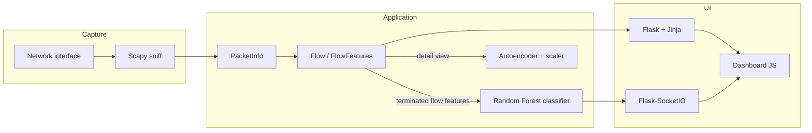

# Network Intrusion Detection System 

Real-time **AI-assisted network intrusion detection** that captures live traffic on your machine, groups packets into **flows**, extracts **flow-level features** (similar to CICFlowMeter-style metrics), and classifies each completed flow with a **machine learning model**. Results stream to a **web dashboard** over WebSockets, with optional **flow detail** views that include **LIME** explanations and **autoencoder reconstruction** diagnostics.

---

## Features

- **Live packet capture** via [Scapy](https://scapy.net/) (`sniff`) on the default network interface.
- **Flow assembly** for TCP/UDP over IPv4: flows keyed by `(src, dst, ports, protocol)` with forward/reverse direction handling.
- **Flow termination** on FIN/RST, or after an **idle timeout** (default 600 seconds).
- **39 numerical features** per flow fed to a **Random Forest** classifier (`models/model.pkl`).
- **Risk tiers** derived from attack-class probabilities (Minimal → Very High).
- **Process association** where possible: source/destination ports matched against `psutil.net_connections()` to show **PID** and **process name**.
- **Geolocation hints** for public IPs using the [ipinfo.io](https://ipinfo.io/) JSON API (country flags in the UI when data is available).
- **Dashboard**: live metrics, Chart.js traffic chart, top source IPs, flow table, terminal-style event stream, high-risk alerts, optional attack beep (browser audio).
- **Flow detail page** (`/flow-detail?flow_id=<n>`): full feature table, LIME tabular explanation (placeholder training data—see [Limitations](#limitations)), and Plotly bar chart of largest autoencoder reconstruction errors vs. expected “normal” manifold.

---

## Architecture (high level)



| Component | Role |
|-----------|------|
| `flow/PacketInfo.py` | Parses IP/TCP/UDP fields, flags, sizes, timestamps; builds flow IDs. |
| `flow/Flow.py` | Accumulates packets, computes statistics when a flow ends. |
| `flow/FlowFeature.py` | Mutable feature container (getters/setters). |
| `application.py` | Flask app, Socket.IO, sniff loop, classification, logging, detail route. |
| `templates/` | `index.html` (dashboard), `detail.html` (per-flow analysis). |
| `static/` | CSS, JavaScript, images (flags, LAN icon). |

---

## Tech stack

- **Python 3** (use a version compatible with **TensorFlow 2.11**, typically **3.8–3.10** on many platforms).
- **Flask**, **Flask-SocketIO** — web UI and real-time updates.
- **Scapy** — packet capture and parsing.
- **scikit-learn** / **joblib** — trained classifier pipeline.
- **TensorFlow / Keras** — autoencoder for anomaly-style visualization on the detail page.
- **LIME** — local interpretability for the classifier on the detail page.
- **pandas**, **numpy**, **plotly** — data handling and charts.
- **psutil** — map ports to local processes.

Pinned versions are listed in `requirements.txt`.

---

## Project structure

```
Network intrusion detection system/
├── application.py          # Main entry: Flask, Socket.IO, sniff, classify
├── requirements.txt
├── flow/
│   ├── Flow.py             # Flow lifecycle and feature aggregation
│   ├── FlowFeature.py      # Feature fields
│   └── PacketInfo.py       # Per-packet parsing (Scapy + psutil)
├── models/                 # Not shipped in repo — you must add files (see below)
├── templates/
│   ├── index.html
│   └── detail.html
└── static/
    ├── css/
    ├── js/
    │   └── application.js
    └── images/
```

---

## Prerequisites

1. **Python 3.8+** (align with TensorFlow 2.11 wheels for your OS).
2. **Administrator / root privileges** (or equivalent capability) for raw packet capture—required on Windows, Linux, and macOS in most setups.
3. **Windows**: install **[Npcap](https://npcap.com/)** (or WinPcap) so Scapy can capture; on Linux/macOS ensure libpcap is available and permissions are correct.
4. **Internet access** (optional): used for ipinfo.io country lookup for non-private IPs.
5. **Model files** in a `models/` directory at the project root (see next section).

---

## Required model artifacts

The application **expects** these paths relative to the project root (they are **not** included in this repository):

| File | Purpose |
|------|---------|
| `models/model.pkl` | Trained classifier (`predict` / `predict_proba`). |
| `models/preprocess_pipeline_AE_39ft.save` | sklearn **joblib** preprocessing pipeline for the 39 flow features before the autoencoder. |
| `models/autoencoder_39ft.hdf5` | Keras autoencoder weights. |

If any of these are missing, the app will fail at import or first use of that component. Train or copy artifacts from your ML pipeline and place them under `models/`.

---

## Installation

```bash
cd "Network intrusion detection system"
python -m venv venv
```

**Windows (PowerShell):**

```powershell
.\venv\Scripts\Activate.ps1
pip install -r requirements.txt
```

**Linux / macOS:**

```bash
source venv/bin/activate
pip install -r requirements.txt
```

---

## Running the application

From the project root, with the virtual environment activated and **elevated privileges** for capture:

```bash
python application.py
```

Then open a browser at **http://127.0.0.1:5000/** (default Flask-SocketIO development server).

- Sniffing starts when a client **connects** to the Socket.IO namespace `/test` (the dashboard does this automatically).
- To capture on a **specific interface**, edit `application.py` and pass `iface=` to `sniff`, e.g. `sniff(iface="Ethernet", prn=newPacket)` on Windows or `iface="en0"` on macOS.

---

## Using the dashboard

- **Live table**: each row is a classified flow (source/destination, ports, protocol, timestamps, app/PID if resolved, prediction, probability, risk).
- **Detail**: use the **Action** link to open `/flow-detail?flow_id=<FlowID>` for LIME output, autoencoder error chart, and risk summary.
- **Logs**: on startup the app creates (or truncates) **`output_logs.csv`** and **`input_logs.csv`** in the working directory. These are listed in `.gitignore` for `*.csv`.

---

## Configuration notes (`application.py`)

| Setting | Description |
|---------|-------------|
| `FlowTimeout` | Seconds without packets before a flow is finalized (default `600`). |
| `sniff(prn=newPacket)` | Default interface; change with `iface=...` if needed. |
| `app.config['SECRET_KEY']` | Flask secret; **change** before any production deployment. |
| `app.config['DEBUG']` | `True` in source—disable for production. |

---

## Limitations and caveats

- **LIME**: The explainer is built with **synthetic random data** (`np.random.rand`) as a stand-in for training data. Explanations are **illustrative** until you fit LIME on real feature distributions from your dataset.
- **Classifier labels**: Code comments reference multi-class attack names; the live UI treats non-benign predictions as attacks for counters and alerts. Align training labels with your `model.pkl`.
- **Risk HTML**: Server builds small HTML snippets for risk coloring; the client strips tags for some metrics—behavior is tied to the current string patterns.
- **Security**: Do not expose this service to untrusted networks without hardening (HTTPS, auth, secret key, turning off debug, etc.).
- **Capture scope**: Only traffic visible to the host and interface you sniff is analyzed.

---

## Dependencies (`requirements.txt`)

```
Flask==2.1.1
Flask-SocketIO==5.1.1
simple-websocket==0.5.1
scapy==2.4.5
scikit-learn==1.2.0
joblib==1.2.0
pandas==1.5.1
psutil==5.9.4
lime==0.2.0.1
dill==0.3.6
tensorflow==2.11.0
plotly==5.13.0
Werkzeug==2.2.2
```

Additional imports (e.g. `numpy`) are pulled in as transitive dependencies of the above packages.

---

## Troubleshooting

| Issue | Suggestions |
|-------|-------------|
| Permission denied / no packets | Run the terminal as administrator (Windows) or use `sudo` / capabilities on Linux (`cap_net_raw`). |
| Scapy cannot find interfaces | Install Npcap (Windows) or check `scapy.show_interfaces()`. |
| TensorFlow install fails | Use a [supported Python version](https://www.tensorflow.org/install) for TF 2.11. |
| `models/...` not found | Add the three model files under `models/` as described above. |
| ipinfo always unknown | Check outbound HTTPS; API may rate-limit or block some networks. |

---


